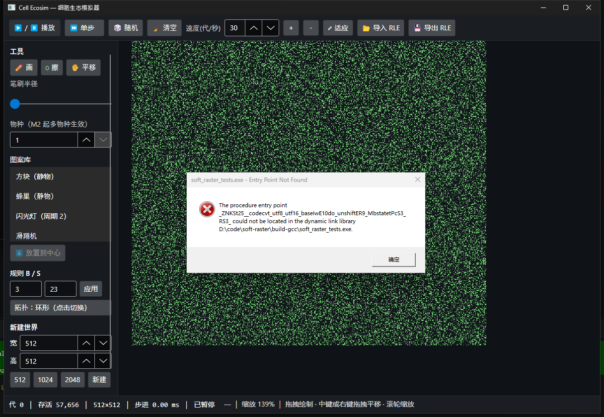
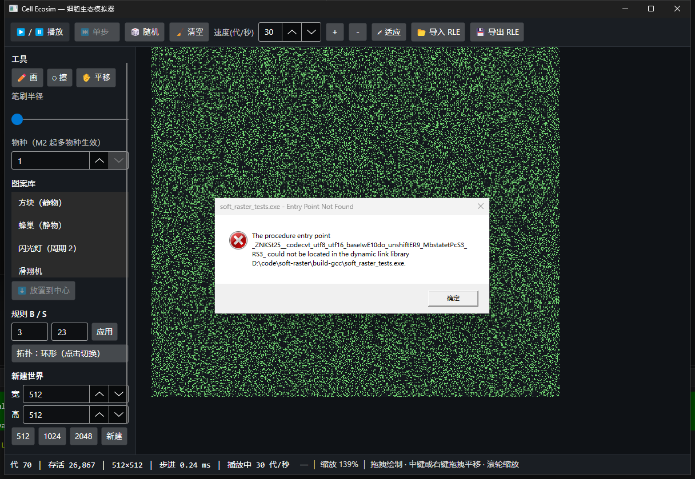

# Cell Ecosim · 细胞生态模拟器

C++ 写的细胞自动机引擎（原生 DLL）+ C# Avalonia 写的桌面前端。最初是一个 Python 版生命游戏的重写，
现在目标是：既能当生命游戏的编辑器/播放器用，也是一个可以调参数、看演化的多物种生态沙盒。

**当前进度：M1 完成** —— 生命游戏完整可玩（画、跑、缩放、平移、图案、规则、RLE 导入导出），
原生 51 项 + 托管 62 项测试全绿。多物种生态（M2）、可视化分析（M3）、打磨（M4）按计划推进。




## 为什么是这个形状

- **C++ 是计算层**：网格状态、规则推进、BGRA 帧合成都发生在原生引擎里，
  SoA 内存布局 + popcount 邻域内核 + 行带多线程。1024² 随机汤 0.39 ms/代。
- **C# 是表达层**：Avalonia 只做呈现与输入转发，模拟逻辑一行都不写在 UI 里。
- **两边只靠一个头文件对话**：`native/include/ecosim_abi.h`，纯 C ABI、不透明句柄、
  每个结构体首字段 `struct_size`，契约"只增不改"。同一套 ABI 也供 headless CLI 使用。
- **时钟在 C# 侧**：原生引擎从不自己起步进线程，所以同一时刻只有一个线程在引擎里；
  托管侧一把锁串行化所有 native 调用，"借用指针直写位图后缓冲"因此是安全的。

设计与取舍全文（含"为什么不用独立后端进程 / C++/CLI"、builder check 的裁定）见
`docs/superpowers/specs/2026-11-21-cell-ecosim-design.md`。

## 快速开始

```bash
scripts/build.sh    # 编 C++ 引擎 → 编 C# 解决方案
scripts/test.sh     # 跑两套测试（ctest + dotnet test）
scripts/run.sh      # 打开应用
scripts/bench.sh    # headless 跑分
```

环境要求与构建细节见 `docs/building.md`；架构与边界纪律见 `docs/architecture.md`；
M1 的实测门槛与缺口见 `docs/m1-checklist.md`。

## 操作

| 操作 | 方式 |
|---|---|
| 绘制 / 擦除 / 平移 | 左键拖拽 / 选"擦"后左键 / 中键或右键拖拽（或"平移"工具） |
| 缩放 | 滚轮（以光标为中心）、＋/－ 按钮、`F` 适应窗口 |
| 播放 / 单步 / 随机 / 清空 | 工具栏或 `Space` / `S` / `R` / `C` |
| 速度 | 工具栏数字框或 `+` / `-` |
| 物种 | 侧栏或 `1` `2` `3` |
| 拓扑切换 | 侧栏按钮或 `Ctrl+G` |
| 导入 / 导出 RLE | 工具栏或 `Ctrl+O` / `Ctrl+S` |

## 图案库

`data/patterns/*.rle` 里的每个图案都要**通过行为测试**才能入库：静物必须不动、
振荡器必须回到原状、飞船必须平移、玛土撒拉必须最终稳定。目前收录
block / beehive / blinker / glider / r_pentomino；Gosper 枪、脉冲星、LWSS
的手抄文本没通过验收，等一个可校验来源（见 `docs/m1-checklist.md`）。

## 目录

```
native/          C++ 引擎：include/ecosim_abi.h 是唯一对外契约
app/Ecosim.Core  托管互操作层（P/Invoke、SafeHandle、时钟、图案库、Viewport、笔刷）
app/Ecosim.App   Avalonia 界面（MVVM，手写绑定基类）
app/Ecosim.Tests 通过真 DLL 跑的集成测试
data/patterns/   已验证的 RLE 图案
docs/            设计、计划、架构、构建说明、里程碑检查
scripts/         构建 / 测试 / 运行 / 跑分
```
